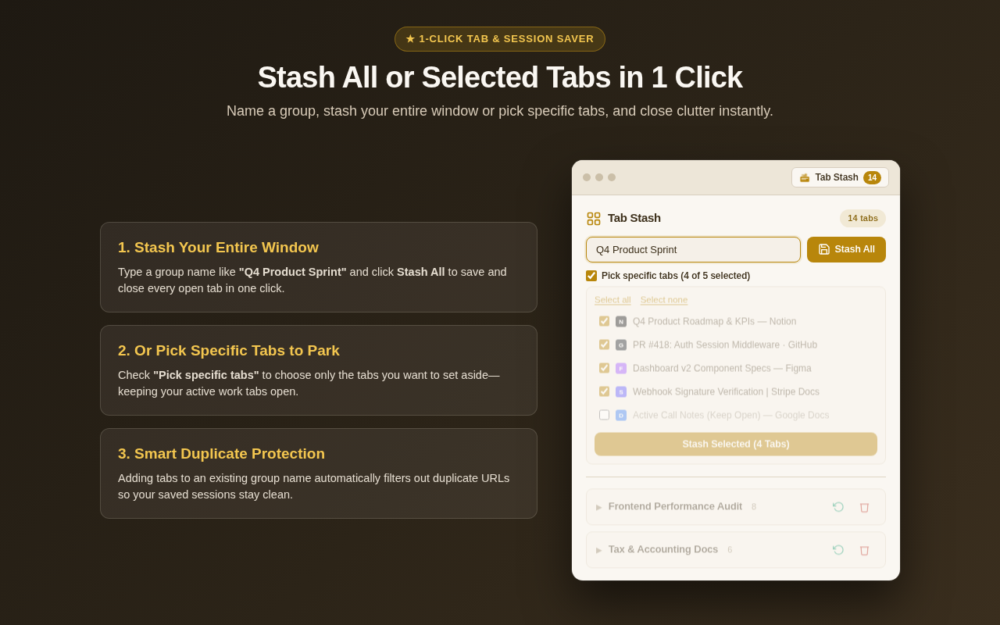
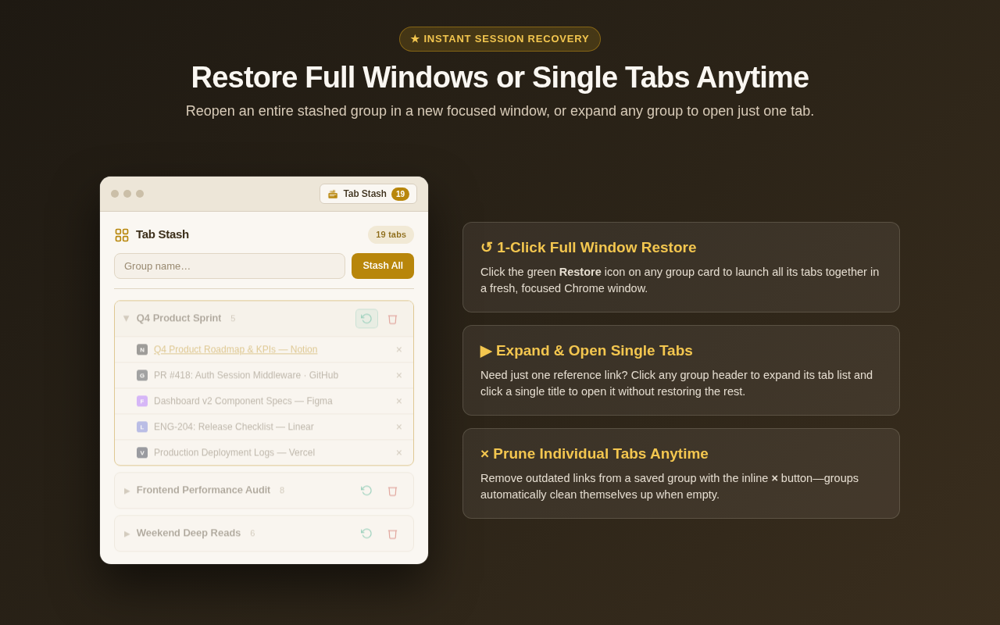
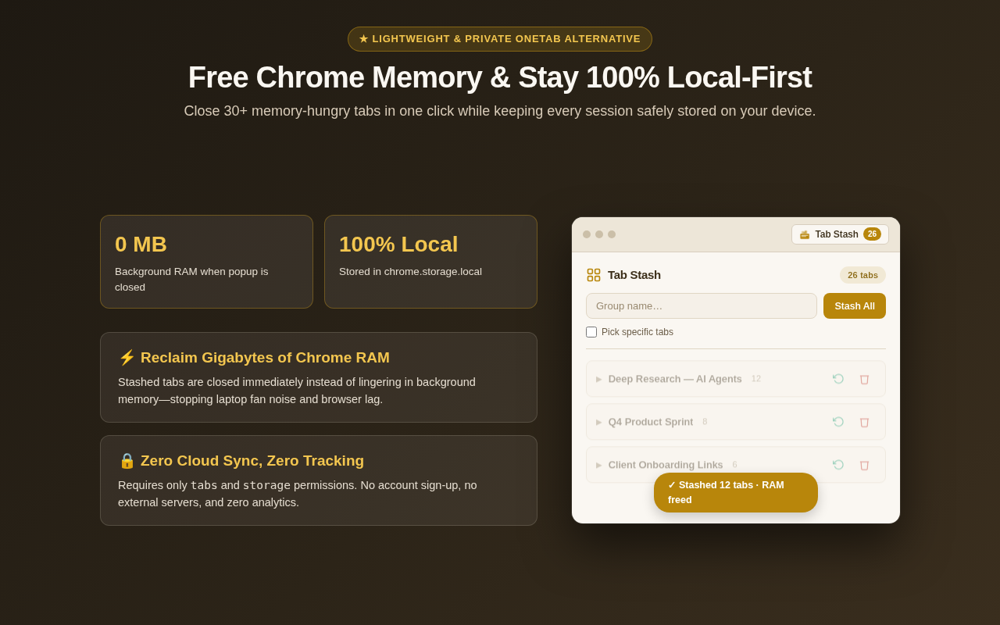

# Tab Stash for Chrome, Edge & Brave — Save & Restore Open Browser Tabs, Groups & Window Sessions

[-B8860B?style=for-the-badge&logo=googlechrome&logoColor=white)](https://chromewebstore.google.com/detail/tab-stash/ijfiohaolfhdaicofjlmldhlajmpcjfe?utm_source=github&utm_medium=readme)

**Tab Stash: Save Tabs & Tab Session Manager** is a fast, lightweight, 100% local-first Chrome extension built for people who keep 20–100+ browser tabs open across research, engineering, shopping, and client work.

👉 **[Install Tab Stash on the Chrome Web Store (Free)](https://chromewebstore.google.com/detail/tab-stash/ijfiohaolfhdaicofjlmldhlajmpcjfe?utm_source=github&utm_medium=readme)**  
🌐 **[Live Interactive Overview & FAQ](https://bilodeam.github.io/tab-stash-chrome/)**

---

## How to Save Open Tabs in Chrome Without Losing Your Place

Most tab managers force an all-or-nothing choice: either collapse your entire browser window into a messy, chronological dump of links, or spend 10 minutes manually bookmarking tabs one by one.

**Tab Stash** gives you a clean popup where you name a session group, choose **Stash All** or **Pick Specific Tabs**, and immediately free up Chrome RAM while keeping every tab organized for 1-click restoration.

### Key Workflows: Stash Selected Tabs vs. Entire Window

1. **Stash All Open Tabs in 1 Click:** Type a group name (e.g., `Q4 Architecture Research` or `Weekend Flights`) and click **Stash All**. Every open tab in your current window is saved, deduplicated, and closed to reclaim memory.
2. **Selective Tab Picker (`Pick specific tabs`):** Need to keep your music, email, or active Google Doc open while parking 15 research tabs? Check **Pick specific tabs**, uncheck the tabs you want to keep open, and click **Stash Selected**.
3. **Restore Full Window or Single Tabs:** Click the green **Restore** button on any saved group to reopen all its tabs in a fresh, focused Chrome window, or expand the group and click a single tab title to open just that page.
4. **Automatic URL Deduplication:** Saving into an existing group automatically skips duplicate URLs so your stashed sessions stay clean.

---

## Why Switch to Tab Stash for Chrome? (Comparison Table)

| Feature | **Tab Stash for Chrome** | Traditional "Collapse All" Tab Lists | Built-in Chrome Bookmarks |
| :--- | :--- | :--- | :--- |
| **Stash only selected tabs** (keep active work open) | ✅ Built-in checkbox picker | ❌ Collapses every unpinned tab | ⚠️ Manual one-by-one |
| **Named, collapsible session cards** | ✅ Clean named groups | ❌ Chronological dump by timestamp | ⚠️ Buried in bookmark folders |
| **1-click restore to a fresh window** | ✅ Yes | ⚠️ Often mixes into current window | ❌ Requires right-click menu |
| **Automatic duplicate URL filtering** | ✅ Automatic per group | ❌ Saves duplicate links | ❌ Saves duplicate bookmarks |
| **100% Local-First (`chrome.storage.local`)** | ✅ Zero cloud servers, zero tracking | ⚠️ Varies | ⚠️ Synced to cloud profile |
| **Permissions required** | ✅ Only `tabs` + `storage` | ⚠️ Often requests `<all_urls>` | ✅ Native |

---

## Privacy & Minimal Permissions

Tab Stash is engineered with strict privacy by design:
- **Zero External Servers:** Every stashed tab title and URL stays on your computer inside `chrome.storage.local`.
- **No Account Required:** Install and start stashing tabs immediately—no sign-up, no OAuth, no telemetry.
- **Minimal Manifest V3 Permissions:** Uses only `tabs` (to read titles/URLs when you stash and close/reopen tabs) and `storage` (to persist your named groups locally).

---

## Frequently Asked Questions (FAQ)

### Is there a Tab Stash extension for Google Chrome, Brave, and Edge?
Yes! **Tab Stash: Save Tabs & Tab Session Manager** brings fast, named tab stashing to Google Chrome, Brave, Arc, Vivaldi, and Microsoft Edge via the [Chrome Web Store](https://chromewebstore.google.com/detail/tab-stash/ijfiohaolfhdaicofjlmldhlajmpcjfe?utm_source=github&utm_medium=readme).

### How do I save only specific open tabs in Chrome without closing my whole window?
Open the **Tab Stash** popup, enter a group name, check **Pick specific tabs**, select the exact tabs you want to park, and click **Stash Selected**. Only your checked tabs are saved and closed.

### Where does Tab Stash store my saved tabs?
All saved groups are stored locally on your machine using Chrome's native `chrome.storage.local` API. Your browsing data is never sent to any external server.

---

## License & Support

- **Chrome Web Store:** [Tab Stash: Save Tabs & Tab Session Manager](https://chromewebstore.google.com/detail/tab-stash/ijfiohaolfhdaicofjlmldhlajmpcjfe?utm_source=github&utm_medium=readme)
- **Privacy Policy & Support:** [https://bilodeam.github.io/drive-renamer-privacy/tab-stash.html](https://bilodeam.github.io/drive-renamer-privacy/tab-stash.html)
- **Contact:** `bilolabs.dev@gmail.com`
